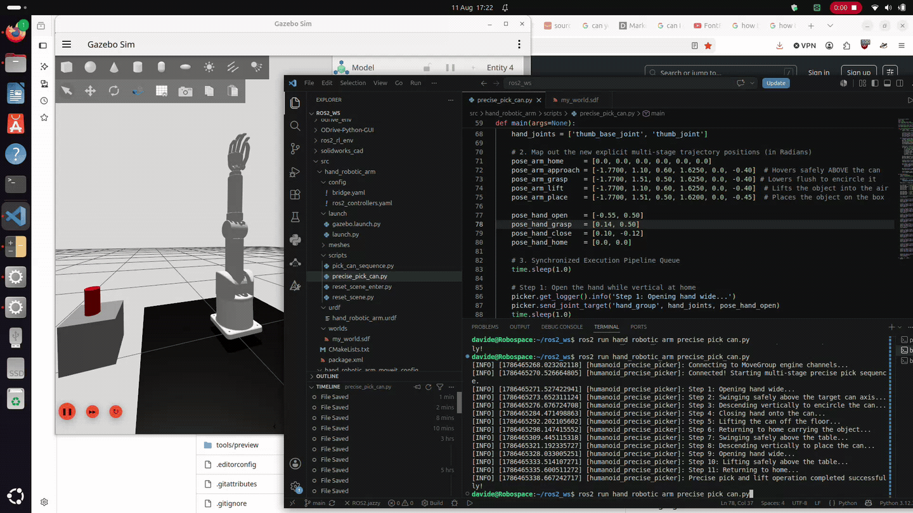

# 9-DOF Manipulator with 5-Fingered Hand Anthropomorphic End-Effector
> **An end-to-end ROS 2 Jazzy & Gazebo Harmonic integration showcase featuring multi-contact humanoid manipulation.**

<p align="center">
  
</p>

## Key Highlights & Engineering Achievements
* **9-DOF Mechatronic Synthesis:** Engineered a high-articulation manipulator combining a 6-DOF positioning arm with a 3-DoF actuated, underactuated anthropomorphic hand framework.
* **Underactuated Kinematic Mapping:** Successfully implemented multi-joint coupling by using ROS 2 mimic constraints to slave 4 independent finger joints to the thumb's primary actuation profile.
* **Modern Middleware Integration:** Developed native control nodes leveraging the **ROS 2 Jazzy** ecosystem, **MoveIt 2**, and **Gazebo Harmonic** via `ros_gz_bridge`.
* **Advanced Physics Tuning:** Resolved contact-force oscillations and cylinder-on-surface instability within the **Bullet-Featherstone** physics engine by engineering a custom composite multi-collision shape workaround.

### Optimized Headless Execution Framework (Bypassing RViz Constraints)
In industrial deployment scenarios, running heavy Graphical User Interfaces (GUIs) like RViz on resource-constrained embedded edge hardware introduces unacceptable CPU/GPU overhead. 

To bridge the gap between simulation verification and hardware optimization, I engineered a custom, consolidated deployment stack that launches the core environment headless:
* **The Planner Brain without the Head Show:** Extracted the core `move_group` executable node parameter mapping directly from MoveIt 2's backend and injected it into the primary Gazebo Harmonic launch sequence (`gazebo_movegroup.launch.py`).
* **Under-the-Hood Parameter Synchronization:** Fully preserved standard factory-built path planning capabilities (OMPL solvers, kinematic trees, and obstacle collision scenes) by compiling and injecting nested data topologies directly into the active ROS 2 parameter bus.
* **Concurrent Real-Time Interfacing:** Configured a custom multi-threaded Python orchestration node (`precise_pick_can.py`) to tap directly into the global `/move_group` action server channels. This enables asynchronous multi-joint trajectory execution loops to run independently without graphical constraints, cutting system initialization footprint drastically.

---
### A Note on my Kinematic Philosophy: Beyond Legacy D-H Constraints
Rather than relying on legacy Denavit-Hartenberg (D-H) matrix parameterizations—which are prone to trigonometric singularities (Gimbal Lock) and high computational overhead—this 9-DOF pipeline treats spatial orientation strictly through **Unit Quaternions ($S^3$ Hypersphere mapping)**. 

By leveraging quaternion-based kinematics representations via native MoveIt spatial solvers, the trajectory planning nodes ensure:
* **Zero Singularities:** Seamless Cartesian navigation even when wrist pitch and azimuth alignment frames approach collinearity.
* **Efficient SLERP Interpolation:** Smooth, lowest-torque geodesic transitions between approach and grasp states for the 5-fingered hand.
* **Reduced Matrix Overhead:** Minimization of rotational floating-point operations, critical for real-time contact-rich feedback loops.

---

## System Architecture

### 9-DOF Humanoid Hand Kinematics & Coupling
Instead of a standard parallel gripper, this manipulator integrates a **custom-designed 5-fingered humanoid hand** driven by complex kinematic constraints:
* **Arm Configuration (6 DoF):** Comprises a Shoulder, Upper Arm, Elbow, Rotating Forearm, Wrist Pitch, and Wrist Yaw joint configuration, enabling full omnidirectional Cartesian reachability.
* **Hand Configuration (3 DoF):** Features an independently driven dual-joint thumb assembly (Thumb Base Joint and Thumb Joint) to coordinate a true human-like opposition grasp profile.
* **Coupled Finger Underactuation:** The 4 remaining structural fingers operate on independent joints but are driven cleanly via **mimic joint control laws** mapped back to the primary thumb driver. This allows high-surface-area wrapping configurations using minimal actuator overhead.
* **Simulation Complexity:** Managed via the **Bullet-Featherstone** engine to properly calculate closed-loop kinematic constraints, joint limits, and force distributions across all 5 contacting fingers simultaneously.

---

## System Architecture Diagram

```text
[ SolidWorks ] ──> [ URDF ]
                      │
                      ▼
[ Trajectory Script Node ] ──> [ MoveIt 2 Motion Planning ] ──> [ ros_gz_bridge ]
                                                                       │
                                                                       ▼
[ Standalone Reset Script ] ─────────────────────────────> [ Gazebo Harmonic ]
                                                            (Bullet-Featherstone)
```


### The Can Spawn "Wobble" Workaround Strategy
Standard cylinder-to-plane physics matrices frequently result in contact torque oscillations in Bullet. When the can is spawned on the table box, it tends to wobble continuously. To combat this *without* introducing false visual barriers or altering the hand's circular interaction zone, I engineered a **composite multi-collision geometry**: embedding a hidden, ultra-thin ($2\text{mm}$) rectangular stabilization box directly into the can base cylinder mesh footprint.

---


## 🎬 11-Step End-to-End Manipulation Pipeline

The entire manipulation loop runs fully autonomously via a synchronized execution pipeline node, coordinating asynchronous joint trajectory executions (`MoveGroup` action requests) and managing multi-finger mimic constraints sequentially.

<p align="center">
  
</p>

### Trajectory Sequence Breakdown
To break down the continuous visual execution shown above, the node organizes the joint trajectory space into 11 explicit, deterministic stages:

| Step | Pipeline Stage | Technical Execution Details |
| :---: | :--- | :--- |
| **01** | **Actuator Initialization** | `hand_group` opens to `pose_hand_open` while the arm remains at vertical home (`[0,0,0,0,0,0]`). |
| **02** | **Approach Translation** | Arm targets `pose_arm_approach`, swinging safely over the top of the target object axis. |
| **03** | **Encircle & Pre-Grasp** | Cartesian descent to `pose_arm_grasp` while aligning thumb opposition values (`pose_hand_grasp`). |
| **04** | **Friction Engagement** | `hand_group` drives to `pose_hand_close`, engaging full contact constraints around the cylinder wall. |
| **05** | **Payload Lift** | Arm executes path planning to `pose_arm_lift`, clearing the support box surface plane. |
| **06** | **Transit Home** | Arm safely targets `pose_arm_home` while holding the 350-gram soda can payload under load. |
| **07** | **Destination Alignment** | Arm transits back to the target coordinates, hovering safely over the deposition plane. |
| **08** | **Object Deposition** | Precision descent to `pose_arm_place`, positioning the object securely back onto the box. |
| **09** | **End-Effector Release** | `hand_group` commands `pose_hand_open`, breaking contact states across all fingers. |
| **10** | **Safety Recoil** | Arm returns to `pose_arm_lift` to clear the newly placed object's height profile. |
| **11** | **System Reset** | Final joint configurations return completely to home positions (`pose_arm_home` / `pose_hand_home`). |


## Quick Start & Deployment

### Prerequisites
* Ubuntu 24.04 LTS
* ROS 2 Jazzy Jalisco
* Gazebo Harmonic
* MoveIt 2

### Installation & Build
```bash
# Clone the repository into your ros2 workspace src directory
cd ~/ros2_ws/src
git clone https://github.com/G1taman/hand_robotic_arm.git

# Install dependencies and build
cd ~/ros2_ws
rosdep install --from-paths src --ignore-src -r -y
colcon build --packages-select hand_robotic_arm hand_robotic_arm_moveit_config

# Source the workspace
source install/setup.bash
```

### Running the Project
In terminal 1, launch the primary simulation environment and control systems:
```bash
ros2 launch hand_robotic_arm gazebo_movegroup.launch.py
```

In terminal 2, execute the custom interactive pipeline reset framework to rapidly loop manipulation iterations without environment crashes:
```bash
python3 src/hand_robotic_arm/scripts/precise_pick_can.py
```

In terminal 3, execute the asynchronous scene manager to instantly reset the target can with a single keystroke
```bash
python3 src/hand_robotic_arm/scripts/reset_scene_enter.py
